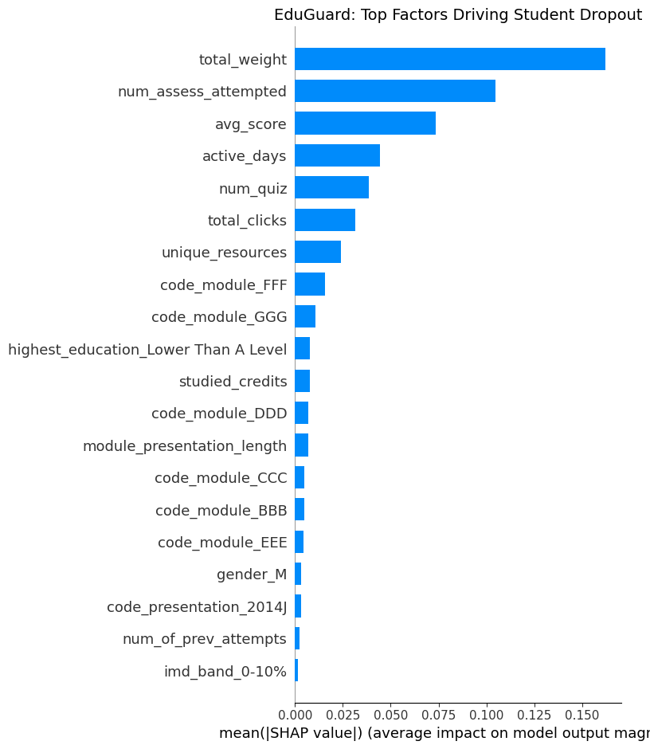
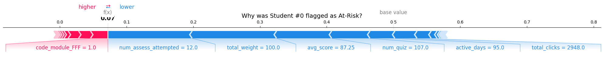

# 🛡️ EduGuard: Proactive Identification of At-Risk Students Using Machine Learning

## 📖 Overview
EduGuard is an Explainable AI (XAI) system designed to predict student dropout risk using the Open University Learning Analytics Dataset (OULAD). By identifying at-risk students early, educators can provide targeted, empathetic interventions before a student ever decides to withdraw.

## 🎯 Key Results
* **Model:** Random Forest Classifier (Balanced Class Weights)
* **Accuracy:** 93.5%
* **ROC-AUC:** 0.9813
* **Explainability:** SHAP (Global and Individual Force Plots)

## 🛠 Tech Stack
Python, Pandas, Scikit-learn, SHAP, Matplotlib, Google Colab

## 📊 Visualizations
Here is a look at what the model uncovered:

### 1. Global Feature Importance
This chart shows the top factors driving student dropout across the entire dataset. Features higher up have a larger impact on the model's predictions.

### 2. Individual Student Explanation (SHAP Force Plot)
This plot explains exactly why a specific student was flagged as at-risk. Red bars push the prediction toward dropout, while blue bars pull it toward safety.

## 🚀 How to Run
1. Open the .ipynb notebook in Google Colab or Jupyter.
2. Upload the final_dataset.csv file.
3. Run all cells sequentially.
